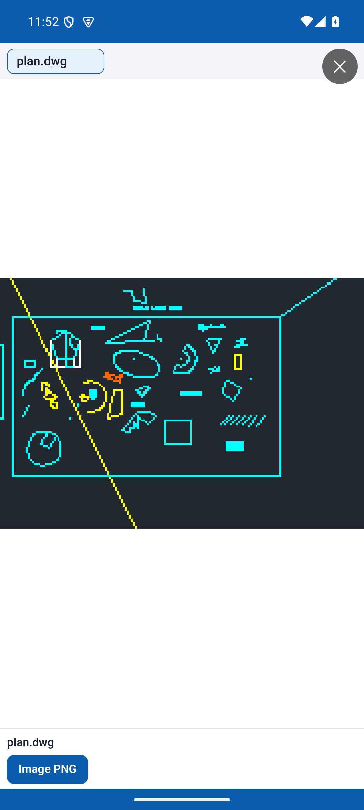

# Lecteur de fichiers pour Android

Une application Android qui ouvre et convertit plus de 60 extensions de fichiers directement sur le téléphone, y compris sans connexion : plans DWG et DXF, modèles 3D STEP, PDF, Word, Excel, PowerPoint, photos HEIC, e-mails Outlook et boîtes PST.

**Rien ne quitte le téléphone.** L'application ne demande pas la permission Internet : Android lui interdit tout accès au réseau.

Conçue par [Jérémy Gonin](https://jeremyai.fr), coach en intelligence artificielle, et développée avec Claude Code.

<p align="center"></p>

## Ce qu'elle fait

- Ouvre un fichier depuis l'application, ou depuis « Ouvrir avec » et « Partager » dans n'importe quelle autre application.
- Affiche aussitôt l'image du fichier en plein écran, avec zoom à deux doigts.
- Ouvre un dossier entier, sous-dossiers compris, jusqu'à 100 fichiers.
- Reconnaît le vrai format d'après le contenu, même si l'extension est fausse.
- Convertit vers PDF, Word, images, CSV ou STL selon le fichier.
- Affiche toujours quelque chose : si un lecteur échoue, une lecture minimale prend le relais.

## Comment elle est construite

- [`app/`](app/src/main/java/fr/jeremyai/lecteur/MainActivity.kt) : l'application Kotlin. Une WebView affiche le lecteur et reçoit ses fichiers depuis l'application elle-même, sans réseau.
- [`site-source/`](site-source) : le lecteur web embarqué, compilé, qui tourne entièrement sur le téléphone (WebAssembly pour le DWG et le STEP).
- [`site-source/js/android.js`](site-source/js/android.js) : le pont entre le lecteur et Android (enregistrement, impression, fichiers reçus).
- [`tests/banc.py`](tests/banc.py) : un banc de test qui pilote l'application sur émulateur.

## Essayer

```bash
JAVA_HOME=/chemin/vers/jdk17 ANDROID_HOME=/chemin/vers/android-sdk ./gradlew assembleDebug
```

Le fichier d'installation se trouve ensuite dans `app/build/outputs/apk/debug/`. Il faut Android 8 ou plus récent.

Pour le banc de test, placez vos fichiers d'essai dans `tests/fichiers/`, ouvrez l'application sur un émulateur, puis lancez :

```bash
python3 tests/banc.py
```

Les fichiers d'essai ne sont pas publiés dans ce dépôt.

## État du projet

Prototype 0.1.0, testé sur émulateur Android 15. Limites connues :

- Certains plans DWG complexes ne s'ouvrent pas en entier : l'application montre alors la petite image enregistrée dans le fichier.
- Les très gros fichiers restent à vérifier sur un vrai téléphone.

## Licence

Ce projet est distribué sous licence [GPL-3.0](LICENSE), car il intègre LibreDWG. Les bibliothèques embarquées sont listées dans [NOTICE.md](NOTICE.md).

Le dossier `site-source/` contient la version compilée du lecteur web, car ses sources d'origine ne sont plus disponibles. Les retouches qui y sont apportées sont décrites dans [NOTICE.md](NOTICE.md).
